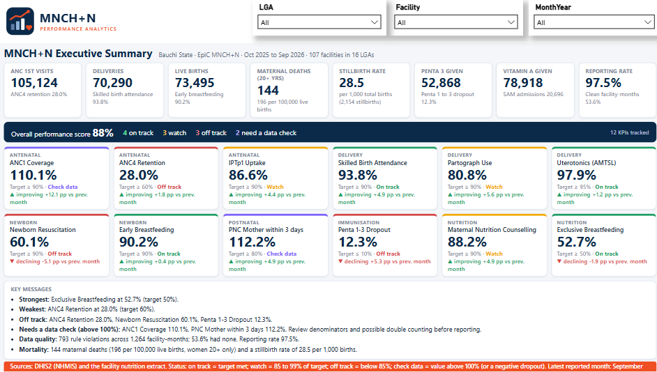
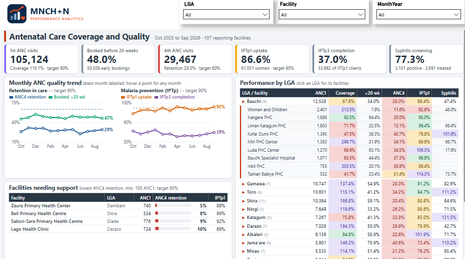
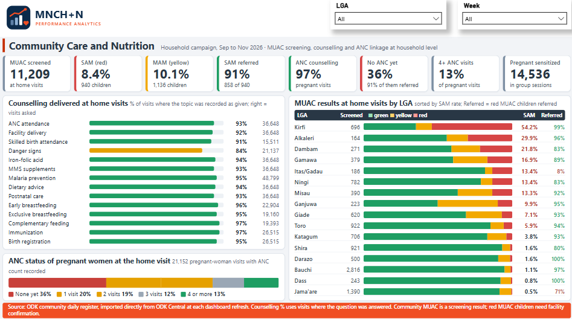
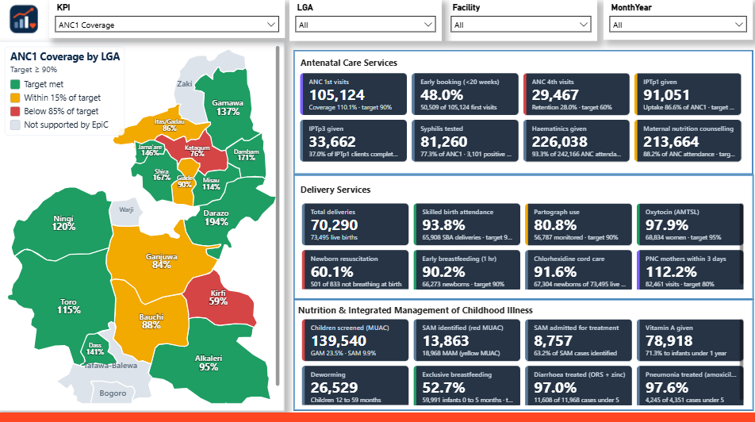
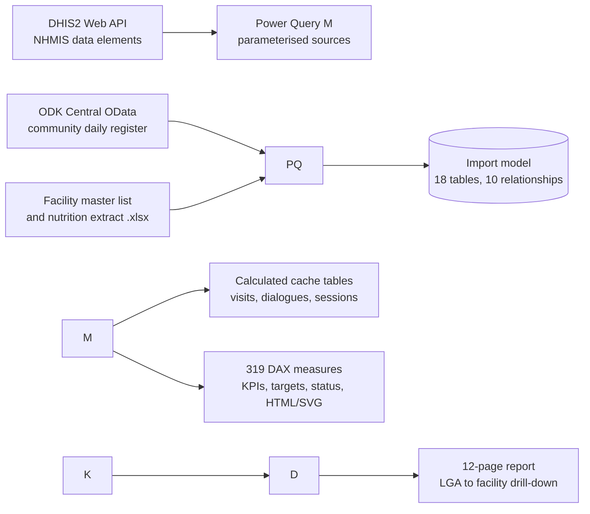

<p align="center">
  
</p>

<h3 align="center">A Power BI performance dashboard for maternal, newborn, child health and nutrition programmes</h3>

<p align="center">
  
  
  
  
  
</p>

<a href="https://doi.org/10.5281/zenodo.24438732"></a>

## Overview

This dashboard brings three data streams that usually live apart into one model: routine facility reporting from DHIS2 (Nigeria's NHMIS), community health worker records collected on ODK Central, and facility-level programme extracts. It was built to track MNCH+N service delivery across 107 health facilities in 16 Local Government Areas (LGAs) of Bauchi State, Nigeria, for the October 2025 to September 2026 reporting year.

The aim was simple. A state programme manager should be able to open one report on a Monday morning and know, within a minute, which indicators are on track, which LGAs are slipping, which facilities are driving the gap, and whether the numbers can be trusted.

> \*\*No data ships with this repository.\*\* It contains the Power BI template (`.pbit`), which holds the model, measures and report layout only. You connect it to your own DHIS2 instance, ODK Central server and facility files.

## What the report covers

|Page|What it answers|
|-|-|
|Welcome Note|What the dashboard is, how to read it, and the community component in brief (92 wards, 16 LGA champions, 291 community-based health workers)|
|Cover Page|Scope, reporting period and navigation|
|Executive Summary|Twelve headline indicators against target, an overall performance score, and auto-generated key messages|
|Key Indicators|The full indicator set with month-on-month direction|
|ANC Coverage|ANC1, ANC4 retention and IPTp uptake, by LGA and facility|
|Mortality|Maternal deaths, stillbirths and newborn outcomes, by LGA with facility drill-down|
|Deliveries|Skilled birth attendance, partograph use, uterotonics (AMTSL) and delivery data-quality checks|
|Nutrition|Counselling, MUAC screening, SAM/MAM, vitamin A and deworming|
|Community Outreach|Household visits, community dialogues and sensitisation sessions from ODK|
|Community Care \& Nutrition|Client-level counselling and referral completion from community visits|
|Backstop Accountability Matrix|Which supervisor owns which facility, and how each portfolio is performing|
|End|Contacts and data notes|

## Screenshots






## How it is built



### Design decisions worth a look

**Import over DirectQuery.** The first version read community data through DirectQuery to another published model. It worked on the desktop and broke in the service with gateway errors. The current build pulls straight from the ODK Central OData feed and pre-aggregates visits, dialogues and sessions into calculated cache tables keyed to LGA. Community pages went from 5 to 15 seconds per render to roughly half a second.

**Status logic that flags bad data instead of celebrating it.** Every indicator is scored against its target with four states: on track (at or above target), watch (85 to 99 percent of target), off track (below 85 percent), and check data (a coverage value above 100 percent or a negative dropout, which usually means a numerator or denominator problem). A 110 percent ANC1 coverage is shown as a data question, not a success.

**HTML and SVG written in DAX.** KPI cards, the executive summary, the LGA map and the brand marks are measures that return HTML or SVG, rendered through the HTML Content visual. This keeps layout, colour and conditional formatting in version-controlled code rather than in hundreds of hand-set visual properties.

**Drill-down that reconciles.** On the Mortality, Deliveries, Nutrition and ANC pages, selecting an LGA expands it to its facilities. Facility rows sum back exactly to the LGA total (for the reporting year: 70,290 deliveries, 105,124 ANC1 visits, 139,540 children screened), so a manager can follow a gap to the facility causing it.

**Parameterised sources.** Server addresses and credentials are Power Query parameters, so the same template can point at a different state, programme or DHIS2 instance without editing a single query.

## Indicators on the executive page

|Domain|Indicator|Target|
|-|-|-|
|Antenatal|ANC1 coverage|90%|
|Antenatal|ANC4 retention (ANC4 / ANC1)|60%|
|Antenatal|IPTp1 uptake|90%|
|Delivery|Skilled birth attendance|90%|
|Delivery|Partograph use|90%|
|Delivery|Uterotonics for AMTSL|95%|
|Newborn|Newborn resuscitation|90%|
|Newborn|Early initiation of breastfeeding|90%|
|Postnatal|PNC for mothers within 3 days|80%|
|Immunisation|Penta 1 to 3 dropout|10% or lower|
|Nutrition|Maternal nutrition counselling|90%|
|Nutrition|Exclusive breastfeeding|50%|

Targets live in a single `KPI Targets` table, so they can be changed without touching a measure.

## Repository layout

```
mnchn-performance-dashboard/
├── MNCHN\_Performance\_Dashboard.pbit   # model + report, no data
├── assets/                            # logo, mark, social preview
├── docs/
│   ├── SETUP.md                       # connecting your own sources
│   └── screenshots/                   # report pages (synthetic or aggregated data)
├── LICENSE
└── README.md
```

## Getting started

1. Install [Power BI Desktop](https://www.microsoft.com/power-platform/products/power-bi/desktop) (Windows).
2. Download `MNCHN\_Performance\_Dashboard.pbit` and open it.
3. When prompted, fill in the five parameters: `DHIS2\_Username`, `DHIS2\_Password`, `ODK\_OData\_Url`, `FacilityList\_Url` and `NutritionExtract\_Url`.
4. Sign in to each source when Power BI asks (Basic for DHIS2 and ODK Central, Organisational account for SharePoint files).
5. Refresh. The first load takes a few minutes depending on the DHIS2 period range.

See [docs/SETUP.md](docs/SETUP.md) for the expected columns in the facility files and the ODK form structure.

## Data protection

The template contains no records, no credentials and no internal server addresses. The screenshots in `docs/screenshots` use aggregated LGA-level figures only. If you adapt this work, keep client-level ODK data and any facility-identifiable outcomes out of public repositories.

## Author

**Moses Luke**, Strategic Information, Research and Database Management. MPH (Epidemiology and Biostatistics); PhD candidate, Health Information Management and Biostatistics.

[LinkedIn](https://www.linkedin.com/in/moses-luke) · [GitHub](https://github.com/Moses-L) · [ORCID 0000-0002-0600-6660](https://orcid.org/0000-0002-0600-6660)

Questions, ideas for reuse in another state or country, or a bug in a measure: open an issue.

## Citation

```
Luke, M. (2026). MNCH+N Performance Dashboard: a Power BI template for maternal, newborn, child health and nutrition programme monitoring (Version 1.0.1) [Computer software].
Zenodo. https://doi.org/10.5281/zenodo.24438732
```

## License

MIT. See [LICENSE](LICENSE).

